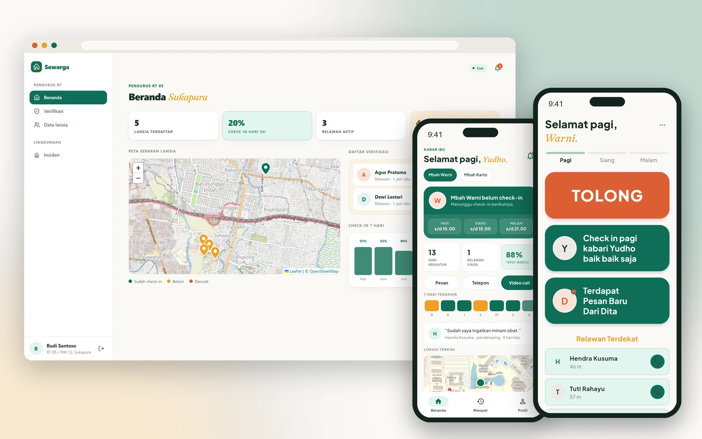
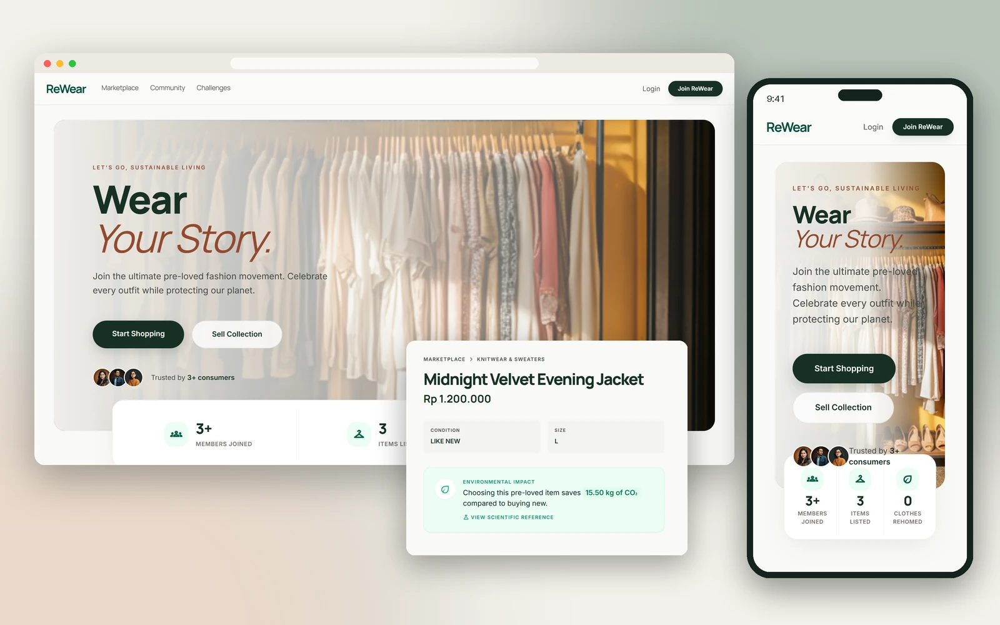
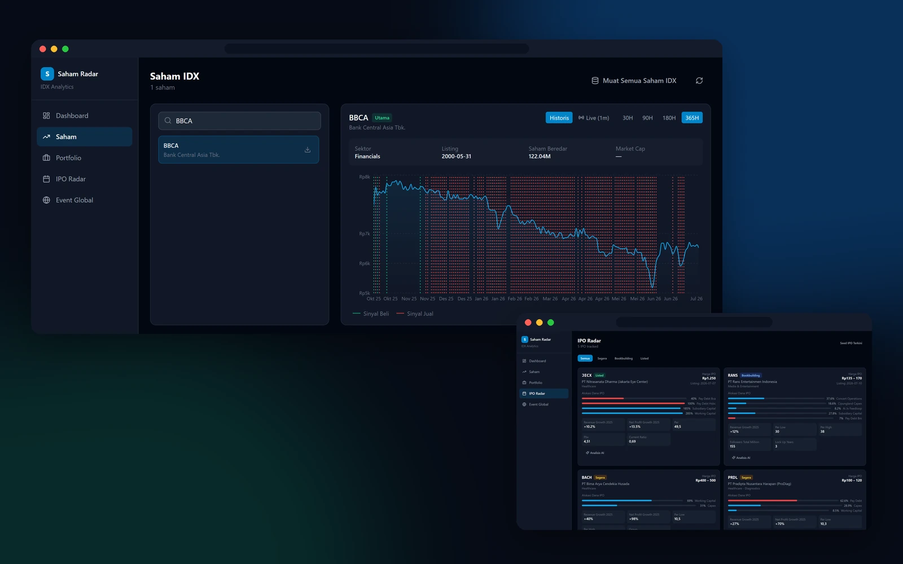

<div align="center">

<a href="https://rohelio-saputra.vercel.app"></a>

<a href="https://rohelio-saputra.vercel.app"></a>

<a href="https://rohelio-saputra.vercel.app"></a>
<a href="https://www.linkedin.com/in/rohelio-saputra"></a>
<a href="mailto:roheliomarusis@gmail.com"></a>
<a href="https://www.instagram.com/dio_gshdjq"></a>

</div>

<br>

## `> CHARACTER`

<table>
<tr>
<td width="62%" valign="top">

```yaml
player:   Rohelio Marusi Saputra
class:    Front-end & mobile developer
base:     Bandung, Indonesia
guild:    Information Systems, Telkom University (2023-2027)
special:  Figma -> Flutter
status:   OPEN FOR WORK  # freelance, internships, remote
```

Most software problems I've seen weren't broken code. They were **confusing screens**.
I study how businesses use information systems, so I look at an app from both sides:
the process behind it and the person tapping it. I design in **Figma** first, then ship it in **Flutter**, **React** and **Laravel**.

</td>
<td width="38%" valign="top">

**ABILITIES**

🟢 **A · Map it**
Who uses it, and what they need to see first.

🩷 **B · Design it**
Flows and components in Figma before any code.

🟡 **X · Ship it**
Branches, pull requests and tests, so it merges clean.

</td>
</tr>
</table>

## `> INVENTORY`

<div align="center">

| | |
|:--|:--|
| **Mobile** |  |
| **Web** |  |
| **Back-end & data** |  |
| **Design & workflow** |  |

</div>

## `> SELECT LEVEL`

<table>
<tr>
<td colspan="2">

### 01 · Sewarga &nbsp;<sub>`FULL STACK` `SOLO` `IN PROGRESS`</sub>
<a href="https://rohelio-saputra.vercel.app/#work"></a>

An elder-care network for one neighbourhood. Seniors check in three times a day and have one big **TOLONG** button. Family far away see their status and can video call, and verified RT volunteers get the alert live.
<br><sub>Flutter · React · FastAPI · WebSocket · WebRTC · Figma</sub>

</td>
</tr>
<tr>
<td width="50%" valign="top">

### 02 · ReWear &nbsp;<sub>`TEAM OF 6`</sub>
<a href="https://github.com/ReWear-GROUP-C/Rewear-Website"></a>

A marketplace for pre-loved clothes that shows how much CO₂ each purchase saves. **My part:** wishlist, favorites, post-purchase feedback, seller reputation and reviews.
<br><sub>Laravel · Tailwind CSS · SQLite · Pest</sub>

</td>
<td width="50%" valign="top">

### 03 · Saham Radar &nbsp;<sub>`PERSONAL`</sub>


Tracks 958 stocks on the Indonesia Stock Exchange: daily buy and sell signals, an IPO radar with AI summaries, and a portfolio that reads Stockbit CSV exports.
<br><sub>React · FastAPI · APScheduler · Recharts</sub>

</td>
</tr>
<tr>
<td colspan="2">

### 04 · Duitku &nbsp;<sub>`MOBILE`</sub> &nbsp;&nbsp; <a href="https://github.com/rohelio323/duitku"><sub>view repo ↗</sub></a>
A personal finance app in Flutter for tracking income, spending and monthly balance in Rupiah.

</td>
</tr>
</table>

## `> QUEST LOG`

```diff
+ [IN PROGRESS]  2023-2027     Information Systems, Telkom University (Bandung)
+ [COMPLETE]     Jun-Sep 2026  IT Support Intern (MBKM), PT NOV Profab Indonesia (Batam)
+ [COMPLETE]     2021-2023     Avionics Electrical, SMK Penerbangan
```

## `> HIGH SCORES`

<div align="center">


<br>

<picture>
  <source media="(prefers-color-scheme: dark)" srcset="https://raw.githubusercontent.com/rohelio323/rohelio323/output/pacman-contribution-graph-dark.svg">
  
</picture>

</div>

<div align="center">

<a href="https://rohelio-saputra.vercel.app/#contact"></a>

</div>
